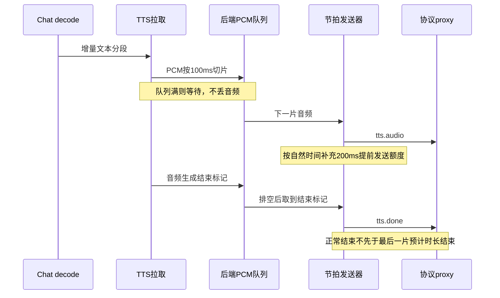

# 后端音频 Buffer 与发送节拍

## 适配范围

上线分支 `feature/duplex-online-service`，基线 `457a7bb`。
对应已检查的 proxy 提交 `11d9762`，该提交移除了代理侧音频队列、
按时间放行和正常结束屏障，要求后端承担这些职责。
本次不修改 AVAD、VASD、VAED、PREFILL/DECODE 判断或模型推理协议。

实现位于独立工作区 `/tmp/duplex-online-pacing-20261124`。
原模型兼容工作区和正在运行的 8080/8081 服务未替换。

## 配置

```json
{
  "server_policy": {
    "interrupt_policy": "new_user_turn",
    "downlink_chunk_ms": 100,
    "downlink_lead_ms": 200,
    "downlink_buffer_ms": 400
  }
}
```

这三个值仅由服务端文件配置，客户端 configure 不能覆盖；
`/defaults` 和 `configured.config` 会返回实际值。
chunk 允许 20–500ms，buffer 允许 chunk 到 60000ms 的整数。
lead 允许 chunk 到 2000ms，默认 200ms；chunk 不得大于 lead。
lead 是已发送音频相对预计播放进度的提前量，buffer 是后端待发队列
资源上限，默认短缓冲 400ms，两者不是攒满才发送的条件。
原 `playback` 模式保留即时发送路径，不启用新的节拍策略。

## 调度



第一片立即发送，每片最多 `downlink_chunk_ms`。
如果已有足够音频，默认可立即发两片100ms，然后每约100ms补一片，
将累计发送的音频终点限制在自然时间进度加200ms的窗口内。
数据断供后重新按当前时间起算，最多补满lead，不累积无限历史额度。
网络发送耗时也会重锚，不能让过去的空闲时间产生巨大突发。
buffer 容量按完整片数量向下取整；队列外另有正在发送的一片、
TTS 拉取返回的当前块和网络/音频服务自身缓存，不是进程总内存限制。

文本 decode、TTS 合成和音频发送仍并行；`chat.done` 可以早于 `tts.done`。
`tts.done.samples` 是实际发出的采样数，PCM 元数据和 request_id 保持不变。

## 新话轮取消

VASD 接纳新话轮后，沿用现有 `new_user_turn` 取消入口：

1. 取消旧 Chat/TTS 任务。
2. 取消并等待旧音频拉取、发送任务退出，丢弃待发队列和结束屏障。
3. 发送原生 `chat.cancelled` 或 `tts.cancelled`。
4. proxy 转换成打断收口；旧轮不再发送音频或正常 `tts.done`。

取消事件之前已交给网络的音频不可撤回。
因此不依赖客户端清理也能停止后续音频，但不是瞬间停止已发音频。
没有客户端播放反馈时，自然时钟仅代表后端估算，不代表真实播完。
不提供网络延迟、客户端缓存或跨轮听感严格无重叠的保证。
中断历史保留仍按已生成正文加 `⏸`，不假装映射到了实际已播放字词。

## 验证

聚焦验证通过：发送器四项及 WebSocket 三项，不启动或替换真实模型。
覆盖无损切片、采样时长、缓冲反压、取消清空、断供不突发、
正常结束屏障、新话轮取消和旧即时流式路径。
生产部署、真实 proxy/客户端联调、网络回压和长音频负载需后续验收。

实际命令均先 source 用户 env.sh 并 conda activate omni；
`python -B -m unittest test_downlink_audio` 等价的定向 loader 四项通过，
WebSocket 定向运行 `test_svad_debug.DebugServiceTests` 中
`test_paced_audio_end_and_cancel_without_playback`、
`test_new_user_turn_interrupts_without_playback_feedback`、
`test_tts_streams_one_task_with_incremental_text`，三项通过。
后者使用 mock AVAD/模型/TTS 的真实回环 WS，不是 GPU 语音质量验收。
当前服务不会因本次源码修改自动更新，部署需后续授权。

用户澄清后，将最初逐片等待/10s队列方案修正为200ms提前发送窗口/
400ms短队列；此前测试记录对应最初方案，本次已更新测试断言后重跑。

## 2026-11-25 发布状态更新

上文的未部署描述是实现阶段记录。2026-11-24 已经授权部署到
`28.29.216.252:8080`，独立运行目录为
`workspace/logs/20261124T100504Z_online_lead_n79azdxj`。
实际服务读取该目录的配置快照，不会随工作区文件自动更新。
真实语音验证收到 24 个文本 delta、71 个音频事件，PCM 时长 6.905 秒，
首音频至正常结束耗时 6.905696 秒，观测提前量不超过 0.199924 秒。
真实 proxy/客户端取消联调与网络、负载验收仍开放。

2026-11-25 用户要求仅提交并推送到 `feature/duplex-online-service`，
不合并 main，不重新部署或修改正在运行的模型兼容服务。
