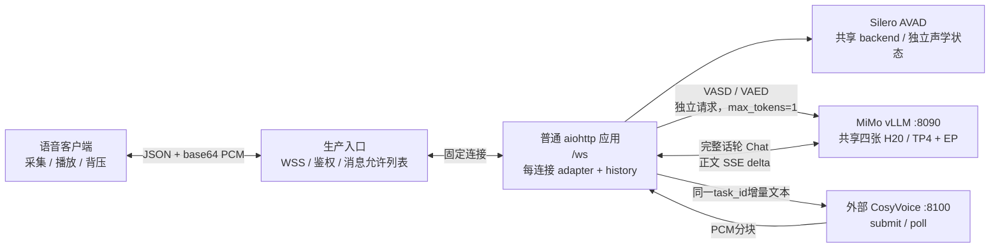
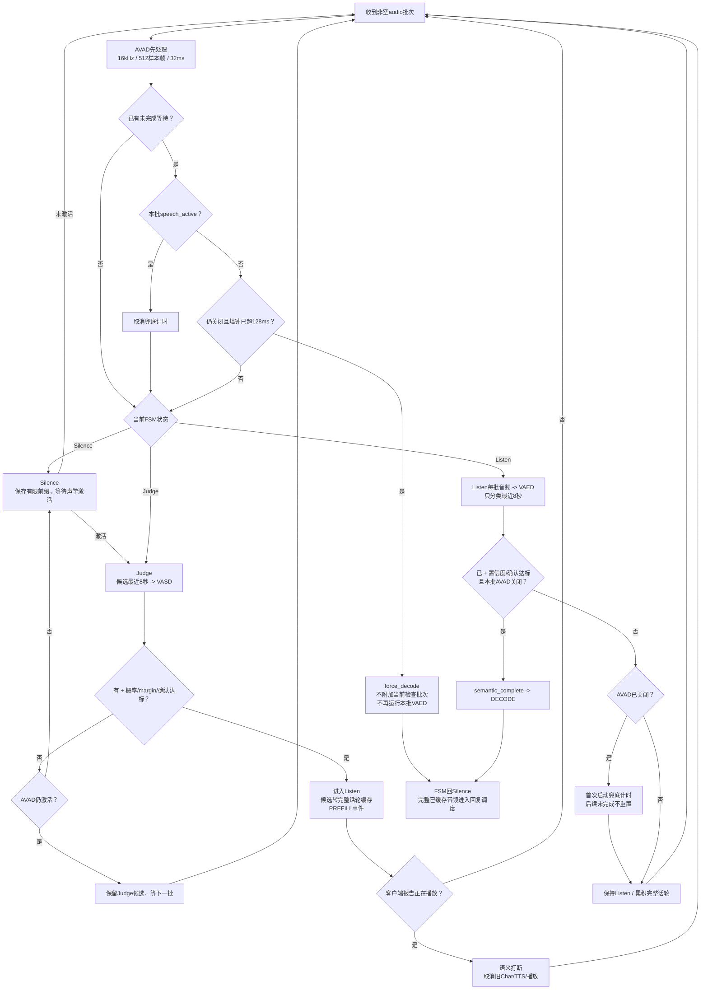
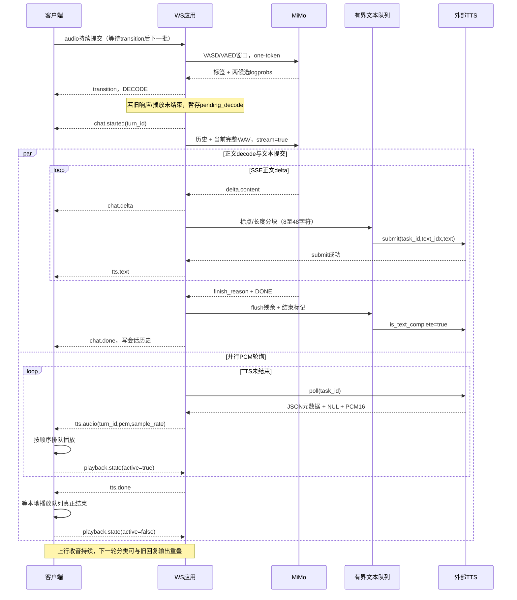
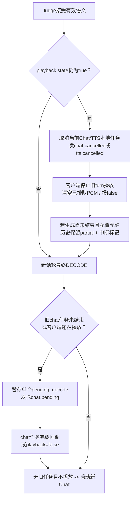

# 完整调度图

本图描述当前纯语音普通 provider、`vaed_mode=chunk` 的实际应用调度。
不包含video、tools或Agent。Mermaid源码可直接渲染；文字段落说明关键边界。

## 1. 服务拓扑与资源

VASD、VAED和Chat都竞争同一个MiMo引擎，应用没有专用分类GPU队列、
请求优先级隔离或已验收固定并发数。TTS GPU由外部owner管理。
TP/EP是模型内部并行，不能解释为四个独立用户服务副本。

## 2. 输入 FSM 与语义端点

- 每批先同步执行AVAD，再await语义判定；AVAD与VAED不是并行竞争。
- AVAD把收到样本按32ms处理，不足一帧留给下一批，声学静音按样本累计。
  `speech_active=false`是滞回/连续静音后的关闭，不是单帧低概率。
- VASD只有Judge执行，首个激活批次可同次进入Judge并分类；进入Listen后不再跑VASD。
- chunk轮询是每个收到的非空Listen批次，包括静音；不是独立200ms定时器。
  分类窗口按完整批次滑动，单批超窗口仍保留该整批，不保证精确裁剪8000ms。
- 完成门槛：`已`、probability>=0.8、margin>=2、连续次数>=1、AVAD关闭。
  说话时的“已”可累积确认，但不能Decode；关闭批次会重新判VAED，
  不是取旧“已”缓存直接Decode。未合格会清零确认。
- `128ms`从AVAD关闭且某次VAED未接受后的时刻开始按墙钟计。
  后续批次先检查超时，超时则直接Decode，不进行这一批VAED。
  用户恢复语音取消等待。`0`关闭该兜底。
- 256ms声学门控与128ms兜底不是固定总延迟，实际受批次相位、语义请求、
  GPU排队、是否首次合格等影响。兜底没有独立timer，缺少后续音频就不检查。
- 分类只用窗口，Chat用整轮已缓存音频。FSM `PREFILL/CHUNK_PREFILL`
  是应用事件/缓存契约；当前普通服务到DECODE才发完整WAV的Chat请求，
  不代表此前已把每块送入同一engine session增量KV prefill。

## 3. 回复、流式 TTS 与播放时序

正文、TTS submit、TTS poll是独立异步任务；文本队列maxsize=8形成背压，
队列满时正文转发会等待。一个回复共用一个TTS task_id，text_idx递增，
最后发送文本结束标记。不是等待完整decode后才统一送TTS。
短回复可能早于首PCM结束decode；长回复应验收首PCM与decode的重叠。

`chat.done`表示文字完成并写入历史；`tts.done`表示服务端PCM流完成；
两者都不是用户已听完。客户端需要在最后PCM播放完后报告false。
`listening`由Chat Prompt控制，精确该值不朗读；不算额外FSM分类阶段。
客户端必须保留此控制值的处理，不把它当普通回答念出。

## 4. 打断与 pending 调度

当前不是同时说话模式：播放中的有效语义会打断，未放通噪声不会打断。
客户端不报告播放状态会破坏此策略，不能只消费音频而省略上行状态。
取消停止本地SSE消费、TTS submit/poll和浏览器播放；外部TTS无取消API，
不承诺已提交远端工作立即释放GPU。

每连接最多一个活动Chat任务、一个待启动decode槽，不是无限多话轮队列。
客户端用turn_id隔离旧PCM、取消事件和新回复，已缓冲数据不会被撤回。
生成中保留的是已生成文字，不是已播放字级对齐；decode已完成的历史不会
因随后播放打断被改写为精确已听文本。

## 5. 会话生命周期与容量

每个WS创建独立FSM、声学状态、历史、队列和任务。新连接先configure，
连接断开取消所属响应并释放adapter，历史不持久化。reset清空历史/候选/
当前响应/pending。configure重建输入adapter和响应设置，不是跨实例热迁移。

引擎调度沿用部署runtime的vLLM scheduler；本应用没有增加可承诺的
跨用户公平调度、分类优先级或并发 admission control。生产入口须配置
连接与话轮限额，并以压测结果确定容量，不能用“能建立多个WS”当容量验收。
30轮原始音频历史、8秒分类窗口以及长轮WAV都会占内存/上下文预算。

## 6. 日志读法

| 字段/组合 | 含义 |
|---|---|
| `request_kind=VASD_SEM` | Judge语义有效性请求 |
| `request_kind=VAED`、command=`<c>` | 模型输出“已”，不保证门控接受 |
| `<c>` + `speech=true` + `completion_accepted=false` | 语义完整但AVAD未关闭，继续Listen |
| `semantic_complete` + `completion_accepted=true` + `speech=false` | 语义和声学共同通过，直接Decode |
| `incomplete_silence_timeout` + `NOT_RUN` | 本批超时兜底，不再请求VAED |
| UI `AVAD · NOT_RUN` | 无request_kind时显示AVAD；不是AVAD没有执行 |

实际例子（2026-11-09，北京时间）：15:39:41.394，VAED“已”、
probability99.88%/margin6.75，但speech=true不提交；15:39:41.587，
本批重新判“已”且speech=false，semantic_complete直接Decode。
证据：`workspace/logs/20261109T071156Z_mac_echo_7bf548e5/entry.log`。
该开发会话含可选视频，不作为本次纯语音范围隔离或生产音频验收证据。
