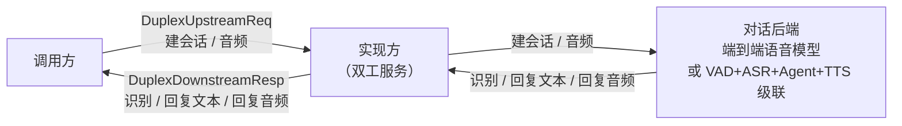
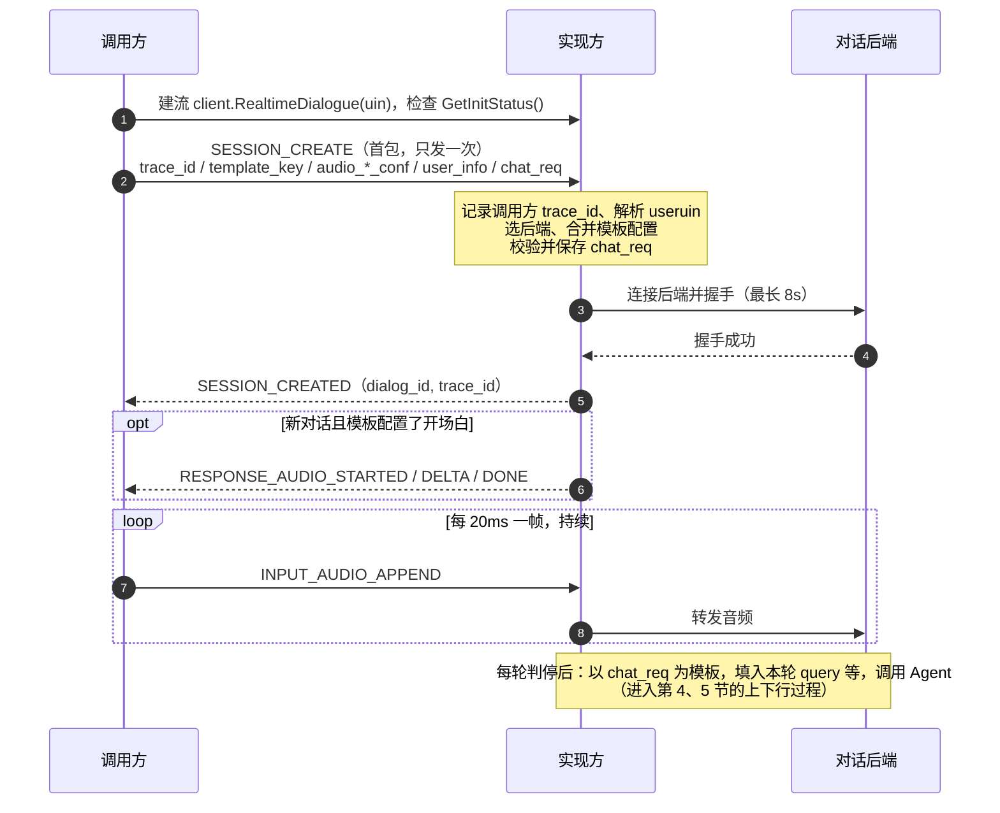
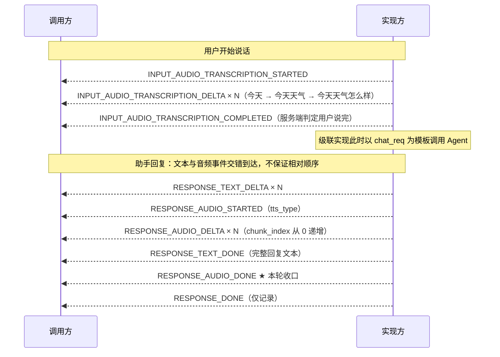
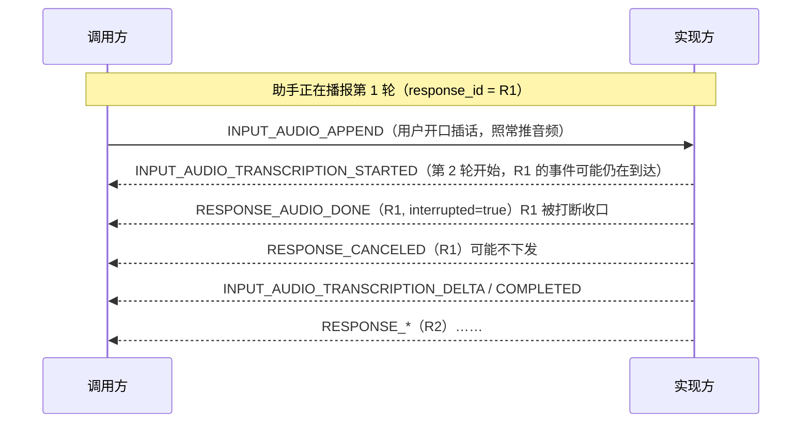
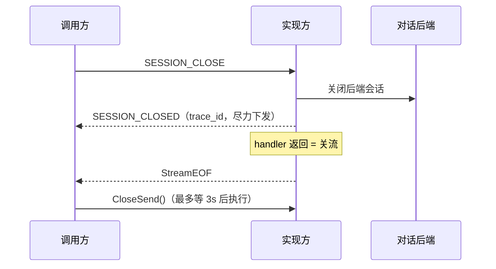

## 1. 整体链路


- **全双工**：上行音频与下行事件同时进行，互不等待。何时判停、何时回话由实现方（服务端 VAD）决定，调用方不需要管理"轮次"。
- **插话（打断）**：用户在助手播报时直接说话即可，调用方继续送音频，不需要发任何额外指令。
- **Agent 上下文**：建会话时可通过 `SessionConf.chat_req` 一次性传入对话 Agent 请求模板（人设、场景、设备、实验等），实现方每轮复用，详见 4.4。
- 一通对话对应一条流，**不要复用流**；对话结束即关流。

---

## 2. 接口约定（svrkit）

### 2.1 rpc 定义

业务在自己的 service proto 中 import 标准协议，声明一个双向流 rpc：

```protobuf
import "weixin/mmfinderluban/infra/sdk/audio/proto/duplex_dialogue.proto";

service XxxSvr {
    option( tlvpickle.UinType ) = "wxuin_t";
    option( tlvpickle.Magic )   = <业务自己的 magic>;

    rpc RealtimeDialogue(stream lubaninfra.audio.duplex.DuplexUpstreamReq)
        returns (stream lubaninfra.audio.duplex.DuplexDownstreamResp) {
        option (tlvpickle.CmdID)          = 1;
        option (tlvpickle.OptString)      = "";
        option (tlvpickle.Usage)          = "";
        option (tlvpickle.RpcRouteMethod) = "kConHash";
    }
}
```

BUILD 依赖：

| 用途 | target |
| - | - |
|  C++ 消息定义  |  `//weixin/mmfinderluban/infra/sdk/audio/proto:duplex_dialogue_proto`（已传递依赖 `mmfinderdrxiaozhiagentsvr/proto:agent_proto`）  |
|  skproto2* 规则 import 用  |  `//weixin/mmfinderluban/infra/sdk/audio/proto:duplex_dialogue.proto`  |

`duplex_dialogue.proto` import 了 `weixin/mmfinderluban/mmfinderdrsocialai/mmfinderdrxiaozhiagentsvr/proto/agent.proto`（`SessionConf.chat_req` 的类型 `mmfinderdrsocialai.ChatReq`）。接入方 C++ 侧需要的头文件：`duplex_dialogue.pb.h` 与 `agent.pb.h`。

### 2.2 约定

| 项 | 约定 |
| - | - |
|  调用方式  |  svrkit 双向流（newrpc stream），`ClientStreamSenderRecverPB<DuplexUpstreamReq, DuplexDownstreamResp>`  |
|  路由  |  `kConHash`，按建流时传入的 uin 一致性哈希；同一通对话的 uin 必须固定  |
|  用户身份  |  `SessionConf.user_info.useruin`（业务用户 uin）；不填则回落 svrkit header uin  |
|  消息格式  |  proto2 二进制；音频字段为原始字节，**不是 base64**  |
|  兼容性  |  只新增字段、不改号不改类型。双方遇到不认识的 `type` / 字段一律忽略，不能报错  |
|  已接入服务  |  `mmassistantlubanduplexproxysvr`，Magic 28265，CmdID 1（`RealtimeDialogue`）。其 proto 与标准协议 wire format 兼容；v1.1 新增的 `chat_req` 对它是未知字段，会被忽略  |

---

## 3. 连接过程

### 3.1 时序


### 3.2 步骤说明

1. **建流**：`client.RealtimeDialogue(uin)`。`GetInitStatus()` 非 OK 表示路由不可达 / 服务未启动 / 被拒绝，这是唯一会整体失败的地方，调用方应上报并退避重试。
2. **建会话**：建流后**第一个包必须是** `SESSION_CREATE`，且整条流只发一次。

    - 在它之前送的音频会被丢弃；重复的 `SESSION_CREATE` 会被忽略。
    - 除 `type` 外，**`trace_id` 必填**（调用方生成，全局唯一），其余字段都可选；整块 session 不填 = 全部走实现方默认配置（字段见 4.3）。
    - 需要定制 Agent 行为（场景、人设、设备、实验、位置等）时，在 `session.chat_req` 里一次性传入（见 4.4）。会话中途**不能修改**，要改只能新建会话（可带 `dialog_id` 续聊）。

3. **实现方处理建会话**：

    - `trace_id` 原样使用调用方传入的值，**不改写**（为空时参考实现兜底生成 `{uin}-{毫秒}`，仅为兼容，调用方不应依赖）；
    - `useruin` 为空时回落 header uin；
    - 按 `template_key` 展开模型、人设、音色、热词等配置，调用方传入的音频格式 / 音色覆盖模板默认值；
    - 保存 `chat_req` 作为本会话的 Agent 请求模板，并按 4.4 的规则补齐 / 校验；
    - 连接后端并完成握手。

4. **会话就绪**：握手完成后实现方下发 `SESSION_CREATED`，带：

    - `session.dialog_id`：对话上下文 id，**调用方存住**，下次建会话填回即为续聊；
    - `session.trace_id`：原样回带调用方在 `SESSION_CREATE` 传入的 `trace_id`，可用于核对；报障时用它对账。

5. **开场白（可选）**：新对话（`dialog_id` 为空）且模板配置了开场白时，实现方会在就绪后立刻下发一轮回复（`RESPONSE_*` 事件），此时用户还没说话，调用方要能正常播放。
6. **推音频**：收到 `SESSION_CREATED` 后开始持续推音频（第 4 节）。

### 3.3 建会话失败

| 现象 | 含义 | 调用方动作 |
| - | - | - |
|  收到 `ERROR`（`err_code=2002`），随后流结束  |  后端启动 / 握手失败或超时  |  结束本通对话，可退避重试（新建一条流）  |
|  收到 `ERROR`（`err_code=2001`）  |  参数 / 配置非法（含 `chat_req` 校验失败）  |  结束本通对话，**不要原样重试**，检查参数  |
|  未收到任何下行，流直接结束  |  `ERROR` 为尽力下发，可能丢失  |  同 2002  |
|  **10 秒内**没有收到 `SESSION_CREATED`  |  握手卡住  |  调用方主动发 `SESSION_CLOSE` 并关流，按失败处理  |

---

## 4. 上行过程（调用方 → 实现方）

### 4.1 上行事件

| type | 值 | 载荷 | 说明 |
| - | - | - | - |
|  `UPSTREAM_TYPE_SESSION_CREATE`  |  1  |  `session`  |  建会话，首包，只发一次  |
|  `UPSTREAM_TYPE_INPUT_AUDIO_APPEND`  |  2  |  `audio`  |  送一帧用户音频  |
|  `UPSTREAM_TYPE_INPUT_AUDIO_COMMIT`  |  3  |  —  |  可选：强制判停（例如按键说完）。正常由服务端 VAD 判停，不需要发  |
|  `UPSTREAM_TYPE_RESPONSE_CANCEL`  |  4  |  —  |  可选：主动打断当前回复。**实现方可以忽略**（端到端模型实现只记日志、不转发，模型会自行处理），插话无需发它  |
|  `UPSTREAM_TYPE_SESSION_CLOSE`  |  5  |  —  |  挂断  |

`req_id`：可选的请求级标识，只用于实现方日志串联，下行不回带。

### 4.2 音频约定

| 方向 | 默认格式 | 可选格式 | 节奏 |
| - | - | - | - |
|  上行  |  PCM s16le / 16000Hz / 单声道  |  `speech_opus`  |  **20ms 一帧（PCM 为 640 字节）**，按真实时间节拍持续送  |
|  下行  |  `pcm_s16le` / 24000Hz / 单声道  |  `pcm`（**float32**）、`ogg_opus`  |  随回复流式到达  |

上行要求：

- **持续送，包括静音**。服务端 VAD 依赖静音判断用户说完，调用方不要在本地做 VAD 裁剪，也不要在用户不说话时停止推流。
- **按真实时间节拍送**，不要攒成大包，也不要突发补发历史音频。麦克风天然按 20ms 驱动；用文件模拟时需要自己控制节拍。
- `audio_input_conf` 声明的格式、采样率必须与实际送的音频一致，实现方不做转码。
- `chunk_index`：建会话后从 0 递增。填了实现方会据跳号统计丢帧；不填则实现方按到达顺序补号。
- `audio.meta` 只需首帧填写，不填按会话配置。

注意：下行格式 `pcm` 是 **float32**，要 int16 PCM 请用 `pcm_s16le`（默认值）。

### 4.3 建会话参数（SessionConf）

| 字段 | 默认 | 说明 |
| - | - | - |
|  `trace_id`  | **调用方生成并传入（必填）** | 链路追踪 id，**报障对账的唯一凭据**。需全局唯一，例如 `{uin}-{毫秒}` 或业务 task_id；实现方原样使用、回带并打印日志（为空时参考实现兜底生成 `{uin}-{毫秒}`，调用方不应依赖） |
|  `duplex_scene`  |  `DUPLEX_SCENE_DEFAULT`  |  业务场景，仅用于分发与统计。新场景取值由协议维护方统一分配  |
|  `template_key`  |  实现方默认模板  |  决定模型、人设、音色、热词、开场白等，由实现方分配给接入方  |
|  `output_modality`  |  `OUTPUT_MODALITY_DEFAULT`（音频 + 文本）  |  输出模态  |
|  `dialog_id`  |  空 = 新对话  |  填上次 `SESSION_CREATED` 回带的值 = **续聊**（续聊不下发开场白）  |
|  `audio_input_conf`  |  `pcm` / 16000 / 1  |  上行音频格式，必须与实际一致  |
|  `audio_output_conf`  |  `pcm_s16le` / 24000 / 1  |  下行音频格式；`voice` / `speed` / `loudness` 不填取模板配置；`speed`、`loudness` 取值 [-50,100]  |
|  `user_info.useruin`  |  header uin  |  业务用户 uin（十进制字符串），用于身份、日志与后端灰度  |
|  `user_info.expt_item_list`  |  —  |  实验值，实现方按需使用，可只透传  |
|  `asst_enter_scene_type`  |  —  |  业务入口场景（小微为 `CBTAsstEnterSceneType`），可选  |
|  `backend_type`  |  —  |  预留，调用方不填；后端由实现方自行选择  |
|  `chat_req`（11，v1.1 新增）  |  空 = 实现方按 uin + `template_key` 自行构造  |  **对话 Agent 请求模板**，类型 `mmfinderdrsocialai.ChatReq`（`mmfinderdrxiaozhiagentsvr/proto/agent.proto`）。建连时一次性传入，会话内每轮复用，规则见 4.4  |

### 4.4 Agent 请求模板（SessionConf.chat_req）

级联实现（VAD + ASR + Agent + TTS）每轮判停后要调用一次对话 Agent。`chat_req` 让调用方在建连时把这次对话的 **Agent 上下文**一次性交给实现方：实现方保存它作为模板，**每轮拷贝一份，只覆盖轮次级字段**，再发给 Agent。

**字段分工：**

| 类别 | 字段（`mmfinderdrsocialai.ChatReq`） | 谁填 |
| - | - | - |
|  会话级（调用方按需填，实现方原样透传）  |  `role`、`role_version`、`scene`、`sub_scene`、`scene_info`、`robot_info`、`device_id`、`chat_type`、`chatroom_id`、`room_info`、`voip_room_info`、`xexp_params`、`extra_info`、`chat_extra_info`、`agent_id`、`agent_version`、`user_loaction`、`clientip`、`clientipv6`、`cbt_asst_mem_info`、`app_bypass_msg`、`bypass_data`、`sender_name`、`target_uin` 等  |  **调用方**  |
|  身份  |  `uin`  |  调用方可填；**必须与** `user_info.useruin`（或 header uin）一致，不一致时以 `user_info.useruin` 为准  |
|  轮次级（每轮由实现方生成并覆盖，调用方填了也会被覆盖）  |  `query`、`audio_data`、`msg_type`、`pic_list`、`timestamp`、`now_timestamp`、`session_id`、`new_session_id`、`chat_history`、`chat_memory_list`、`agent_chat_memory_list`  |  **实现方**  |
|  评测 / 调试（**仅测试环境**，线上不要填）  |  `test_mode`、`is_mock_history`、`mock_history`、`mock_profile`、`mock_full_profile`、`mock_skills`、`mock_now_timestamp`、`mock_data`、`memory_end_time`、`evaluation_info`、`forward_debug_meta`、`ybreq_token`  |  调用方（测试）  |

**约定：**

1. **只在建会话时传一次**，会话中不能更新。需要变更（例如切换场景）请结束会话后重新建会话，可带 `dialog_id` 续聊。
2. 轮次标识 `session_id`（trace_msgid）由实现方每轮生成，必须**全局唯一**（参考实现格式 `<trace_id>_t<轮次>`）。Agent 服务端按它去重，重复会导致空回复。
3. 与 `SessionConf` 其他字段重叠时，以 `SessionConf` 为准：身份看 `user_info.useruin`，链路看 `trace_id`，入口场景看 `asst_enter_scene_type`；`chat_req` 内的同义字段缺省时由实现方用这些值补齐。
4. 体积建议 **< 64KB**：不要在模板里放音频、图片原始数据或长历史，历史与记忆由 Agent 侧自行拉取。
5. `chat_req` 只影响 Agent 调用，不影响 ASR、TTS 与音频格式。
6. 不调用 Agent 的实现（如端到端语音模型后端）可以忽略 `chat_req`，但不能因此报错；如需使用其中的部分信息（如 `scene`、`xexp_params`），由实现方在其接入说明中写明。
7. 实现方发现 `chat_req` 明显非法（例如 `uin` 与用户身份不一致且无法纠正、体积超限）时，下发 `ERROR 2001` 并结束会话。

---

## 5. 下行过程（实现方 → 调用方）

### 5.1 下行事件

`DuplexDownstreamResp` = 外层 `type` + 按事件分槽的载荷（至多一个非空）。

| type | 值 | 载荷 | 接入要点 |
| - | - | - | - |
|  `SESSION_CREATED`  |  1  |  `session`  | 会话就绪；存住 `dialog_id`（续聊用）；`trace_id` 为调用方传入值的回带 |
|  `SESSION_CLOSED`  |  2  |  `session`  |  会话结束。尽力下发，可能收不到，以流结束为准  |
|  `INPUT_AUDIO_COMMITTED`  |  3  |  `committed`  |  `COMMIT` 的回执  |
|  `INPUT_AUDIO_TRANSCRIPTION_STARTED`  |  4  |  `asr`  |  检测到用户开口，新一轮开始  |
|  `INPUT_AUDIO_TRANSCRIPTION_DELTA`  |  5  |  `asr`  | 识别中间结果。`asr.delta` 是**本句（同一个 `item_id`）截至目前的完整文本**，直接覆盖，不要拼接。**`item_id` 变了 = 新的一句**，从空文本重新累积，上一句以其 COMPLETED / 最后一次 delta 定稿 |
|  `INPUT_AUDIO_TRANSCRIPTION_COMPLETED`  |  6  |  `asr`  |  识别结束。`transcript` **可能为空**，为空时以最后一次 delta 为准  |
|  `RESPONSE_TEXT_DELTA`  |  7  |  `response`  | 回复文本流。`delta` 为**增量**（本次新增的片段），按到达顺序**追加拼接**；以 `TEXT_DONE` 的完整文本为准校对 |
|  `RESPONSE_TEXT_DONE`  |  8  |  `response`  | 回复文本结束，`text` 为完整文本 |
|  `RESPONSE_AUDIO_STARTED`  |  9  |  `response`  |  回复音频开始，带 `tts_type`  |
|  `RESPONSE_AUDIO_DELTA`  |  10  |  `response`  |  **回复音频本体**，`response.audio.data`，拿去播放或转 RTP  |
|  `RESPONSE_AUDIO_DONE`  |  11  |  `response`  |  ★ **本轮收口信号**，带 `interrupted`、`exit_intent`、`status_code`  |
|  `RESPONSE_CANCELED`  |  12  |  `response`  |  本轮被打断作废。**可能不下发，不要等它**  |
|  `RESPONSE_DONE`  |  13  |  `response`  |  本轮整体结束，**只做记录，不要用它驱动业务**  |
|  `ERROR`  |  14  |  `error`  |  见第 7 节  |

### 5.2 一轮对话的下行时序


- **本轮完成以** `RESPONSE_AUDIO_DONE` 为准，不要用 `RESPONSE_DONE` 或 `TEXT_DONE` 判断。
- 文本与音频是两条独立的流，相对顺序不保证。展示用文本，播放用音频，各自处理。

### 5.3 插话（打断）时序


调用方处理要求：

1. **所有回复事件按** `question_id` / `response_id` 归集。插话时会有两轮同时在飞，不能只靠"上一条事件"判断归属。
2. 某个 `response_id` 收到 `interrupted=true` 或 `RESPONSE_CANCELED` 时，**立即丢弃该轮尚未播放的本地音频**。
3. 本地播放缓冲不要超过约 300ms 的提前量，否则打断后用户还会听到一段旧回复。
4. 插话不需要发 `RESPONSE_CANCEL`，继续送音频即可。

### 5.4 关键载荷字段

**SessionPayload**

| 字段 | 说明 |
| - | - |
|  `dialog_id`  |  对话上下文 id，下次建会话填回 = 续聊  |
|  `trace_id`  | 本会话 `trace_id`，即调用方在 `SESSION_CREATE` 传入的值（原样回带） |

**AsrPayload**

| 字段 | 说明 |
| - | - |
|  `item_id` / `content_index`  | 定位一段识别。**同一个 `item_id` = 同一句话**，`delta` 只在同一 `item_id` 内累积；出现新的 `item_id` 即开始新的一句 |
|  `delta`  | DELTA：**本句（同一个 `item_id`）**截至目前的完整识别文本；换 `item_id` 后从头累积 |
|  `transcript`  |  COMPLETED：最终文本，可能为空  |
|  `vad_id` / `svad_id`  |  可选：本段声学 / 语义 VAD 的唯一 id（级联实现填写），用于排查判停  |

**ResponsePayload**

| 字段 | 说明 |
| - | - |
|  `question_id` / `response_id`  |  轮次定位，**一律按它归集**  |
|  `delta` / `text`  | TEXT_DELTA 带 `delta`：回复文本**增量**，需追加拼接；TEXT_DONE 带 `text`：本轮完整回复文本 |
|  `tts_type`  |  AUDIO_STARTED 带：`default`、`chat_tts_text`、`network`、`audit_content_risky`（内容风险兜底话术）  |
|  `audio`  |  AUDIO_DELTA 带：`data` 为音频字节，`chunk_index` 每轮从 0 递增，跳号即丢帧  |
|  `status_code`  |  AUDIO_DONE 带：模型侧状态码，透传排障用  |
|  `interrupted`  |  AUDIO_DONE 带：true = 本轮被用户插话打断  |
|  `exit_intent`  |  AUDIO_DONE 带：true = 用户表达了挂断意图（`status_code == "20000002"`）。调用方播完剩余音频后应主动挂断  |

### 5.5 收下行的实现要求

- **收发分离**：用独立的循环持续 `Recv`（单次超时建议 ≤20ms），不能因为播放、写盘、网络转发而长时间不读。实现方的下行发送有流控，调用方不读会导致实现方发送阻塞，超过约 5s 后下行被丢弃。
- `Recv` 返回超时是常态，表示"这次没有下行"，不是错误。
- `StreamEOF()`：实现方已结束本会话；`Broken()`：流异常断开。两者都表示本通对话结束。

---

## 6. 结束过程

| 场景 | 过程 | 调用方看到 |
| - | - | - |
|  调用方挂断  | 调用方发 `SESSION_CLOSE` → 实现方关后端 → 下发 `SESSION_CLOSED` → 结束流  |  `SESSION_CLOSED`（可能收不到）后 `StreamEOF`  |
|  调用方直接关流  | 调用方 `CloseSend()` / 进程退出  |  — （实现方收到 EOF 后清理）  |
|  用户表达挂断意图  |  `RESPONSE_AUDIO_DONE.exit_intent = true`  |  调用方播完后按"调用方挂断"流程处理  |
|  后端异常断开  | 实现方下发 `ERROR`（3000 / 3001 / 3002）  |  收到后调用方应发 `SESSION_CLOSE` 结束  |
|  上行长时间无数据  |  实现方约 **60s** 收不到任何上行即结束会话  |  `SESSION_CLOSED` 后 `StreamEOF`  |
|  后端会话结束  |  后端关闭会话 → 实现方结束  |  `SESSION_CLOSED` 后 `StreamEOF`  |

建议调用方挂断流程：发 `SESSION_CLOSE` → 最多等 3s 的 `SESSION_CLOSED` 或 `StreamEOF` → `CloseSend()`。


---

## 7. 错误处理

`ERROR` 事件的 `error.err_code` 取值（`DuplexErrorCode`）：

| err_code | 名称 | 含义 | 调用方动作 |
| - | - | - | - |
|  0  |  `DUPLEX_ERR_VENDOR`  |  模型 / 供应商透传错误，详情看 `vendor_type` / `vendor_code` / `param`  |  记录；是否致命由实现方决定，致命时实现方随后会结束会话  |
|  2001  |  `DUPLEX_ERR_SESSION_PROTOCOL`  |  请求参数 / 协议错误（含 `chat_req` 非法）  |  结束对话，**不要原样重试**  |
|  2002  |  `DUPLEX_ERR_SESSION_BACKEND`  |  建会话失败（后端启动 / 握手失败、超时）  |  结束对话，可退避重试  |
|  3000  |  `DUPLEX_ERR_BACKEND_UNAVAILABLE`  |  会话中后端流断开  |  发 `SESSION_CLOSE` 结束  |
|  3001  |  `DUPLEX_ERR_BACKEND_CONNECT`  |  连接后端失败  |  发 `SESSION_CLOSE` 结束，可退避重试  |
|  3002  |  `DUPLEX_ERR_BACKEND_CLOSED`  |  后端连接被对端关闭  |  发 `SESSION_CLOSE` 结束  |

除 0 外，所有错误码都表示本通对话不可继续。新建对话请新建流，可带上原 `dialog_id` 续聊。

---

## 8. 标识与对账

| 标识 | 作用域 | 谁生成 | 用途 |
| - | - | - | - |
|  `trace_id`  |  一个会话  | 调用方（`SESSION_CREATE` 传入，必填） |  **报障对账唯一凭据**，各方日志均打印  |
|  `dialog_id`  |  对话上下文（可跨会话）  |  后端  |  续聊  |
|  `chat_req.session_id`  |  一轮 Agent 调用  |  实现方（`<trace_id>_t<轮次>`）  |  Agent 侧去重与对账  |
|  `req_id`  |  一个上行请求  |  调用方，可选  |  仅实现方日志  |
|  `question_id` / `response_id`  |  **一轮回复**  |  **后端**  |  **轮次归集 （重要！！）** |
|  `item_id` / `content_index`  |  **一段识别**  |  **后端**  |  **ASR 定位 （重要！！）** |
|  `vad_id` / `svad_id`  |  一段 VAD  |  级联实现  |  判停排查  |
|  上 / 下行 `chunk_index`  |  会话 / 每轮  |  调用方 / 实现方  |  丢帧检测  |

报障时请提供：`trace_id`、uin、发生时间，以及问题出现在第几轮（或对应的 `response_id`）。

---

## 9. 实现方须遵守的约定

新的双工服务按本协议实现时，必须满足以下行为，调用方才能无差别接入：

1. 流上首包必须是 `SESSION_CREATE`；在它之前的音频丢弃，重复的 `SESSION_CREATE` 忽略，不认识的上行 `type` 忽略。
2. 后端握手完成后才下发 `SESSION_CREATED`，必须**原样回带调用方传入的** `trace_id`（为空时自行兜底生成）；支持续聊的后端必须带 `dialog_id`。
3. 建会话失败下发 `ERROR`（2001 / 2002），然后结束流。
4. ASR `delta` 下发**本句累积全文**；回复文本 `delta` 下发**增量**，`TEXT_DONE` 必须带本轮完整 `text`（且应等于各增量的拼接）；ASR completed 的 `transcript` 尽量填写。
5. 每轮回复都带 `question_id` / `response_id`；每轮回复**必须以** `RESPONSE_AUDIO_DONE` 收口，被打断时也要下发并置 `interrupted=true`。
6. 下行音频 `chunk_index` 每轮从 0 递增，格式与建会话协商的 `audio_output_conf` 一致，不擅自转码。
7. 后端异常时下发 `ERROR`（3000 / 3001 / 3002）并结束会话；会话结束前尽力下发 `SESSION_CLOSED`（带 `trace_id`），之后 handler 返回即关流。
8. 下行发送不得阻塞会话主协程：参考实现中后端 io 线程负责 `Send`（超时 5s），会话协程只用不阻塞的投递。
9. 等待上行期间定期 `KeepAlive`，避免 svrkit 空闲约 30s 断流；上行约 60s 无数据可主动结束会话。
10. `RESPONSE_CANCEL` 可以不支持，但不能因此报错。
11. 按 `trace_id` 打全链路日志，并做会话级上报（结束原因、轮次数、上下行字节、丢帧数）。
12. 调用 Agent 的实现：以 `chat_req` 为模板每轮拷贝，**只覆盖 4.4 中的轮次级字段**，调用方填的会话级字段必须原样透传，不得丢弃；`session_id` 每轮全局唯一；`chat_req` 为空时自行构造。不调用 Agent 的实现可以忽略 `chat_req`。

---

## 10. 调用方接入检查清单

- [ ] 一通对话一条流，不复用；建流 uin 在整通对话内固定
- [ ] 建流后首包发 `SESSION_CREATE`，收到 `SESSION_CREATED` 后再推音频；10s 未就绪按失败处理
- [ ] 需要定制 Agent 时在 `session.chat_req` 填会话级字段；`chat_req.uin` 与 `useruin` 一致；不填轮次级字段，线上不填 mock / 评测字段
- [ ] `SESSION_CREATE` 时**生成并传入** `trace_id`（全局唯一），打印到自己的日志；存住 `dialog_id`
- [ ] 20ms 节拍持续推音频，**静音也要推**，不做本地 VAD 裁剪
- [ ] 独立循环持续 `Recv`，不被播放阻塞
- [ ] ASR `delta` 直接覆盖，不拼接；回复文本 `delta` 按到达顺序追加拼接，收到 `TEXT_DONE` 后以其 `text` 为准
- [ ] 回复事件按 `response_id` 归集；`interrupted=true` / `RESPONSE_CANCELED` 时丢弃该轮未播音频
- [ ] 以 `RESPONSE_AUDIO_DONE` 作为本轮完成信号
- [ ] `exit_intent=true` 时播完后挂断
- [ ] 收到非 0 的 `ERROR` 后结束对话；挂断时发 `SESSION_CLOSE` 再 `CloseSend()`
- [ ] 下行格式需要 int16 时用 `pcm_s16le`（`pcm` 是 float32）
- [ ] svrkit client 线程开头调用 `INIT_SKCOROUTINE`

---

## 附录 A：最简接入代码（C++）

```cpp
#include "weixin/mmfinderluban/infra/sdk/audio/proto/duplex_dialogue.pb.h"
#include "weixin/mmfinderluban/mmfinderdrsocialai/mmfinderdrxiaozhiagentsvr/proto/agent.pb.h"

using namespace ::lubaninfra::audio::duplex;
using Stream = ::spring::ClientStreamSenderRecverPB<DuplexUpstreamReq, DuplexDownstreamResp>;

XxxSvrClient client;
Stream stream = client.RealtimeDialogue(uin);
if (!stream.GetInitStatus().OK()) { /* 上报，退避重试 */ }

// ① 建会话
DuplexUpstreamReq create;
create.set_type(UPSTREAM_TYPE_SESSION_CREATE);
SessionConf* s = create.mutable_session();
s->set_trace_id(my_trace_id);   // 必填：调用方生成，全局唯一，自己也打日志
s->set_template_key("<实现方分配>");
s->mutable_user_info()->set_useruin(std::to_string(uin));
// 可选：Agent 请求模板，只填会话级字段
::mmfinderdrsocialai::ChatReq* chat = s->mutable_chat_req();
chat->set_uin(uin);                        // 与 useruin 一致
chat->set_scene("<业务场景>");
chat->set_device_id(device_id);
chat->set_clientip(client_ip);
// chat->mutable_scene_info()->...;  chat->mutable_xexp_params()->...;
stream.Send(create, 5000);

// ② 发：每 20ms 一帧
DuplexUpstreamReq up;
up.set_type(UPSTREAM_TYPE_INPUT_AUDIO_APPEND);
up.mutable_audio()->set_data(pcm_20ms);          // 640 字节
up.mutable_audio()->set_chunk_index(idx++);
stream.Send(up, 5000);

// ③ 收：独立循环
DuplexDownstreamResp d;
spring::Status st = stream.Recv(&d, 20);
if (st.StreamEOF() || st.Broken()) { /* 本通结束 */ }
if (st.OK()) {
  switch (d.type()) {
    case DOWNSTREAM_TYPE_SESSION_CREATED:        dialog_id = d.session().dialog_id(); break;
    case DOWNSTREAM_TYPE_INPUT_AUDIO_TRANSCRIPTION_DELTA: asr = d.asr().delta(); break;
    case DOWNSTREAM_TYPE_RESPONSE_AUDIO_DELTA:   Play(d.response().response_id(), d.response().audio().data()); break;
    case DOWNSTREAM_TYPE_RESPONSE_AUDIO_DONE:    if (d.response().interrupted()) DropUnplayed(d.response().response_id()); break;
    case DOWNSTREAM_TYPE_ERROR:                  /* 非 0：结束对话 */ break;
    default: break;                              // 不认识的 type 忽略
  }
}

// ④ 挂断
DuplexUpstreamReq close;
close.set_type(UPSTREAM_TYPE_SESSION_CLOSE);
stream.Send(close, 5000);
// 等 SESSION_CLOSED / StreamEOF（≤3s）后
stream.CloseSend();
```

完整可运行示例见 `mmassistant/mmassistantlubanduplex/mmassistantlubanduplexproxy/demo/demo.cpp`。

## 附录 B：参考实现的时间参数（mmassistantlubanduplexproxysvr）

| 参数 | 值 |
| - | - |
|  后端握手等待上限  |  8s  |
|  连接后端超时  |  5s  |
|  下行单帧发送超时  |  5s  |
|  上行无数据结束会话  |  约 60s（5s × 12 次）  |
|  svrkit 空闲断流  |  约 30s（实现方等待期间自动 KeepAlive）  |

## 附录 C：与端到端语音模型事件的对应

| 本协议 | 模型事件 |
| - | - |
|  `SESSION_CREATE` / `SESSION_CLOSE`  |  session.create / session.close  |
|  `INPUT_AUDIO_APPEND` / `COMMIT`  |  input_audio_buffer.append / commit  |
|  `RESPONSE_CANCEL`  |  response.cancel（参考实现不转发）  |
|  `SESSION_CREATED` / `SESSION_CLOSED`  |  session.created / session.closed  |
|  `INPUT_AUDIO_COMMITTED`  |  input_audio_buffer.committed  |
|  `INPUT_AUDIO_TRANSCRIPTION_*`  |  conversation.item.input_audio_transcription.started / delta / completed  |
|  `RESPONSE_TEXT_DELTA` / `DONE`  |  response.output_text.delta / done  |
|  `RESPONSE_AUDIO_STARTED` / `DELTA` / `DONE`  |  response.output_audio.started / delta / done  |
|  `RESPONSE_CANCELED` / `RESPONSE_DONE`  |  response.canceled / response.done  |
|  `ERROR`  |  error  |
