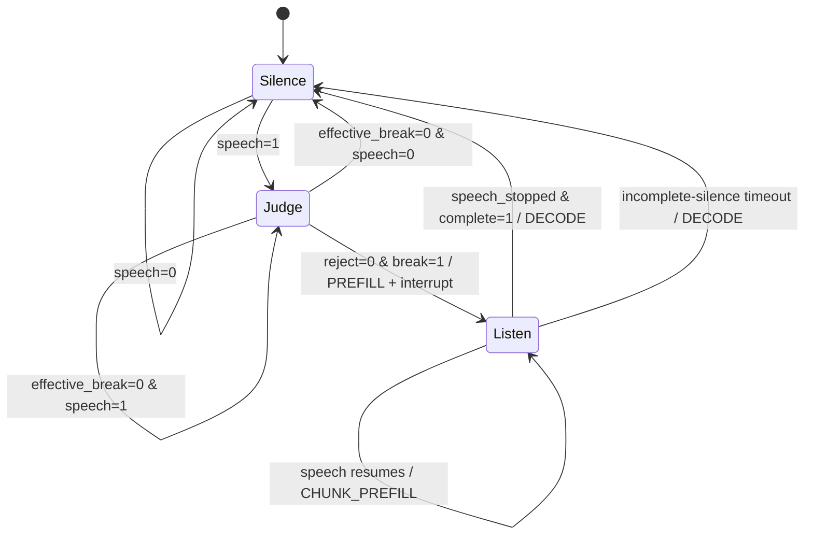

# Duplex Input FSM：AVAD + Semantic VAD 功能规格说明

> 版本：v0.2（VAED 改为声学终点触发，Listen 可跨语义未完成的静音）
> 用途：提供给 Omni模型 作为输入控制模块的实现与验收依据。
> 参考：`speech_fsm_en.pdf`（Speech interaction: VAD FSM and inference behavior）及补充的 Reject 需求。

## 1. 目标

实现一个用于实时双工语音对话的 **Input Controller**。控制器通过独立的声学 VAD（AVAD）和基于 Omni 模型的语义 VAD（VASD、VAED），使用 **三个 FSM 状态**决定当前音频应如何被处理，以及何时向推理系统发出 **Prefill / Chunk Prefill / Decode** 指令。

本期目标是严格复现当前约定，不额外引入其他状态、判定规则或交互策略。

- **AVAD**：是否检测到语音活动，对应 `speech ∈ {0,1}`。
- **VASD**：是否应打断模型，对应 `break ∈ {0,1}`；同时负责无有效语义时的 **Reject（拒识）**。
- **VAED**：当前输入是否已经语义完成，对应 `complete ∈ {0,1}`。
- **FSM**：只有 `Silence`、`Judge`、`Listen` 三个状态。
- **Inference**：按 FSM 事件执行 `Prefill`、`Chunk Prefill` 或触发 `Decode`。

这里的“打断”指发出中断当前模型回复的控制指令；实际停止 Thinker/Talker 生成及播放由下游推理系统执行。

## 2. 模块组成与职责

| 组件 | 输入 | 输出 | 职责 |
|---|---|---|---|
| Acoustic VAD（AVAD） | 实时音频块 | `speech` | 检测声学语音活动；各状态均持续运行 |
| Semantic VASD（Omni） | 待判断音频及必要上下文 | `break`、`reject` | 在 `Judge` 状态判断是否打断；拒绝没有可信语义的声音 |
| Semantic VAED（Omni） | 正在收听的音频及必要上下文 | `complete` | 在 `Listen` 状态判断语义是否结束 |
| Input FSM | 当前状态及上述判定值 | 下一状态、控制事件 | 严格按第 5 节的规则转移 |
| Inference Scheduler（外部） | 控制事件及对应音频 | 执行状态 | 实际执行 Prefill、Chunk Prefill、Decode 或中断 |

> VASD 和 VAED 使用 Omni 模型实现；它们可以共享底层模型实例，但对 FSM 暴露的是两个独立的语义判断接口。此处不规定具体模型、Prompt 或训练细节。

## 3. 语义信号与六个 Special Token

采用以下 **三个二值语义信号、六个 Special Token**；本期不更名、不增加其他 Special Token。

| 信号 | `1` 的 Token | `0` 的 Token | 定义 | 提供方 |
|---|---|---|---|---|
| `speech` | `<s>` | `</s>` | 1：有语音活动；0：无语音活动 | AVAD |
| `break` | `<b>` | `</b>` | 1：应打断模型；0：不打断 | VASD |
| `complete` | `<c>` | `</c>` | 1：语义完成；0：尚未完成 | VAED |

**使用规则：**

1. `speech` 的判定结果由 **声学 AVAD** 提供；`<s>`、`</s>` 是该信号的约定语义标记，不要求 Omni 模型重新执行声学 VAD。
2. `break` 只在 `Judge` 状态作为语义判断参与状态转移。
3. `complete` 只在 `Listen` 状态作为语义判断参与状态转移。
4. 三个信号对 FSM 均为布尔值。上述 Token 映射用于训练标注、消息序列化或日志表达，具体承载方式由实现确定，但不改变其语义。

### 3.1 VASD 的 Reject（拒识）功能

需要识别 **无有效语义** 的音频输入，如纯环境噪声。Reject 不是第四个状态，也 **不增加第七、第八个 Special Token**。

VASD 除 `break` 判定外，还需要输出一个**内部判定标志**：

```text
reject = 1：无法识别出可接受的有效语义；本次音频不应触发打断。
reject = 0：未拒识；继续按 break 判定处理。
```

这属于 VASD 内部输出字段，不是新的模型 Special Token。执行时遵循：

- `reject=1` 时，**有效 `break` 一律视为 0**，不得打断，也不得因为该声音触发 Prefill。
- `reject=0, break=1` 时，允许执行打断转移。
- `reject=0, break=0` 时，按普通的“不打断”路径处理。
- 对于 `speech=1` 且 `reject=1` 的持续噪声，保持 `Judge` 且不发 Prefill；待 `speech=0` 再按原状态机转回 `Silence`。**不要为 Reject 增加额外转移分支。**

可以将 VASD 的逻辑结果表述为 `BREAK` / `NO_BREAK` / `REJECT`，但对 FSM 仍输出 `break ∈ {0,1}`；Reject 是额外的拒识标志，六个 Special Token 保持不变。

## 4. FSM 状态定义

### 4.1 `Silence`

- **职责**：监控是否出现语音活动。
- **运行模块**：AVAD。
- **状态行为**：`speech=0` 时维持 `Silence`；`speech=1` 时进入 `Judge`。
- **不做的事**：不运行 VASD/VAED 判定，不因输入触发 Prefill。

### 4.2 `Judge`

- **职责**：判断当前声音是否应该打断模型。
- **运行模块**：AVAD + VASD（含 Reject）。
- **优先级**：**先判断有效 `break`，否则再依据 `speech` 决定维持或退出。**
- **状态行为**：有效 `break=1` 时进入 `Listen` 并发出 `PREFILL`；有效 `break=0` 且 `speech=1` 时留在 `Judge`；有效 `break=0` 且 `speech=0` 时返回 `Silence`。
- **Reject**：若判定拒识，则有效 `break=0`，不打断模型。

### 4.3 `Listen`

- **职责**：在已确认打断后持续接收完整用户轮次，并在声学停顿点判断语义是否完成。
- **运行模块**：AVAD 持续运行；VAED 只在 AVAD 从 active 变为 stopped 的下降沿运行。
- **语音进行中**：`speech=1` 时不运行 VAED，保持 `Listen`，新增音频触发 `CHUNK_PREFILL`。
- **声学停顿**：`speech_stopped=1` 时，将当前轮次的全部累计音频一次性送入 VAED。
- **语义未完成**：`complete=0 ∧ speech=0` 时保持 `Listen`，允许跨越静音等待用户继续，不触发 Decode。
- **恢复说话**：语义未完成的等待期间重新出现 `speech=1`，继续同一轮 `Listen` 和 `CHUNK_PREFILL`，不重新运行 VASD。
- **语义完成**：只有 VAED 的有效 `complete=1` 才转入 `Silence` 并发出 `DECODE`。
- **超时兜底**：VAED 返回未完成后持续静音超过外部配置的等待时间，可由运行策略触发 `DECODE`；超时不是第四个 FSM 状态。

## 5. 状态转移表（实现的唯一权威规则）

| 当前状态 | 判定条件 | 下一状态 | 对外动作 |
|---|---|---|---|
| `Silence` | `speech=0` | `Silence` | `NO_OP` |
| `Silence` | `speech=1` | `Judge` | 进入打断语义判断；暂不 Prefill |
| `Judge` | `reject=0 ∧ break=1` | `Listen` | `PREFILL`；通知下游打断当前回复 |
| `Judge` | 有效 `break=0 ∧ speech=1` | `Judge` | `NO_OP`；继续判断 |
| `Judge` | 有效 `break=0 ∧ speech=0` | `Silence` | `NO_OP`；结束当前候选输入 |
| `Listen` | `speech=1`（普通语音块） | `Listen` | `CHUNK_PREFILL`；不运行 VAED |
| `Listen` | `speech_stopped=1 ∧ complete=0` | `Listen` | `CHUNK_PREFILL` 当前终点块；跨静音等待 |
| `Listen` | `speech=0 ∧ 已判断 complete=0` | `Listen` | `NO_OP`；不重复运行 VAED |
| `Listen` | 等待期间重新 `speech=1` | `Listen` | `CHUNK_PREFILL`；继续同一轮 |
| `Listen` | `speech_stopped=1 ∧ complete=1` | `Silence` | `DECODE` |
| `Listen` | 语义未完成静音达到外部超时 | `Silence` | `DECODE`（外部兜底策略） |

说明：在表中，“有效 `break=0`”包含 `reject=1` 造成的 `break=0`，以及未拒识且原始 `break=0`。`Judge` 按 **Break 优先** 判断。`Listen` 不再把普通 `speech=0` 直接等价为轮次结束；VAED 的完整轮次判断决定是否结束。



## 6. 对推理系统的控制语义

FSM 只**发出事件**，不在状态机内部实现 GPU 调度、KV Cache 修改或音频播放。

| 事件 | 产生时机 | 下游要求 |
|---|---|---|
| `NO_OP` | 维持或退出没有有效打断的检测阶段 | 不因该事件改变当前模型推理流程 |
| `PREFILL` | `Judge → Listen`，且有效 `break=1` | 发出打断指令；将已接收的当前有效输入送入 Prefill |
| `CHUNK_PREFILL` | `Listen` 中收到新增语音，或收到第一次语义未完成的声学终点块 | 将新增音频 Chunk 送入增量 Prefill |
| `DECODE` | `Listen → Silence`，由声学终点上的有效 `complete=1` 或外部静音超时触发 | 通知下游开始回复决策与 Decode 阶段 |

在 `Silence` 和未确认 `break=1` 的 `Judge` 阶段，FSM 不发出停止生成指令。只有 `break=1` 才使下游接到打断指令。

### 6.1 音频缓存边界

为满足 `Judge → Listen` 时 Prefill 获取有效输入的要求：

- 自 `Silence → Judge` 起，暂存本次候选语音对应的音频块。
- 若有效 `break=1`：将已暂存且尚未送入 Prefill 的音频作为初始输入随 `PREFILL` 一次性提交。
- 若从 `Judge → Silence`（始终未打断）：清空本次候选输入缓存。
- 在 `Listen`：后续新增块通过 `CHUNK_PREFILL` 交付，不重复提交已经 Prefill 的块。
- `Listen → Silence` 后结束本次输入轮次，清理该轮临时缓存。

音频缓存只是实现状态转移所需的数据结构，**不是新增 FSM 状态**。

## 7. 与回复决策模块的接口（参考流程图下半部分）

这部分属于 **Inference System**，不是 Input FSM 的第四个状态。

原流程图定义：收到 `DECODE` 之后，基于 Prefill 完成后最后一个 Token 的表示，提供两路输出：

1. **候选 Decode Token**：常规语言模型输出。
2. **Speak Classification Head**：输出 `p(speak)`。

控制规则：

```text
if p(speak) > τ:
    使用已经产生的候选 decode token
    继续 autoregressive decode
    生成非空回复
else:
    直接返回 EOS
    本轮回复为空
```

- 阈值 `τ` 由外部配置，不在本文件指定默认值。
- SFT 数据中，空回复也应视为有效的模型回复形式，目标形式为输出 EOS、正文为空。
- 本 Input FSM 仅发送 `DECODE` 事件；Speak Head 的计算与决定是否开口，属于下游推理系统职责。

## 8. 建议的接口契约

以下为实现层接口示例；字段名可以适应现有仓库，但语义不可更改。

### 8.1 组件输出

```python
# Acoustic VAD
speech: bool

# Semantic VASD，仅在 Judge 使用
break_decision: bool
reject: bool

# Semantic VAED，仅在 Listen 使用
complete: bool
```

### 8.2 FSM 输入 / 输出

```python
@dataclass
class FSMInput:
    audio_chunk: bytes | object  # 实际类型遵循音频接入层
    speech: bool
    break_decision: bool | None = None
    reject: bool | None = None
    complete: bool | None = None

@dataclass
class FSMOutput:
    state: str                    # Silence / Judge / Listen
    event: str                    # NO_OP / PREFILL / CHUNK_PREFILL / DECODE
    interrupt: bool               # 仅有效 break=1 的转移置 True
    prefill_audio: object | None  # 当前事件需要交付的音频
```

`break_decision` 只在 `Judge` 使用，`complete` 只在 `Listen` 使用。`interrupt=True` 必须与 `Judge → Listen` 的有效 `break=1` 同时发生。

### 8.3 单次事件处理伪代码

```python
def fsm_step(state, speech, break_decision=None, reject=None, complete=None):
    if state == "Silence":
        if speech:
            return "Judge", "NO_OP", False
        return "Silence", "NO_OP", False

    if state == "Judge":
        assert break_decision is not None
        assert reject is not None
        effective_break = bool(break_decision) and not bool(reject)
        if effective_break:                         # break 优先
            return "Listen", "PREFILL", True
        if speech:
            return "Judge", "NO_OP", False
        return "Silence", "NO_OP", False

    if state == "Listen":
        assert complete is not None
        if complete:
            return "Silence", "DECODE", False
        if speech or semantic_endpoint_evaluated:
            return "Listen", "CHUNK_PREFILL", False
        return "Listen", "NO_OP", False

    raise ValueError(f"Invalid state: {state}")
```

伪代码仅规定状态转移；音频缓存、Omni 调用、事件交付和异步执行由具体代码封装。

## 9. 必须覆盖的功能测试

| 编号 | 场景 | 预期结果 |
|---|---|---|
| T01 | 初始为 `Silence`，AVAD 输出 0 | 保持 `Silence`，无 Prefill |
| T02 | `Silence` 收到 `speech=1` | 转入 `Judge`，不立刻打断 |
| T03 | `Judge` 中 `speech=1, break=0, reject=0` | 保持 `Judge`，不打断、不 Prefill |
| T04 | `Judge` 中 `speech=1, reject=1`（纯噪声） | 拒识，保持 `Judge`，无 Prefill、无打断 |
| T05 | T04 后 `speech=0` | 返回 `Silence`，丢弃未提交的缓存 |
| T06 | `Judge` 中 `break=1, reject=0` | 转入 `Listen`，只触发一次初始 `PREFILL` 与打断 |
| T07 | `Listen` 中 `speech=1, complete=0` | 保持 `Listen`，新增音频 Chunk 触发 `CHUNK_PREFILL` |
| T08 | `Listen` 中普通 `speech=1` | 不运行 VAED，保持 `Listen` 并触发 `CHUNK_PREFILL` |
| T09 | AVAD `speech_stopped=1`，完整累计音频 VAED 输出 `complete=0` | 保持 `Listen`，跨静音等待，不触发 Decode |
| T10 | `Judge` 中出现 `break=1, reject=1` | Reject 覆盖 Break，不打断、不 Prefill |
| T11 | 同一音频 Chunk 已经用于初始 `PREFILL` | 不得再次放入 `CHUNK_PREFILL` |
| T12 | 下游 `p(speak)>τ` | 使用候选 token 继续生成非空回复 |
| T13 | 下游 `p(speak)≤τ` | 直接 EOS，回复正文为空 |
| T14 | T09 后用户恢复 `speech=1` | 继续同一轮 `Listen` 和 `CHUNK_PREFILL`，不经过 Judge |
| T15 | 后续 `speech_stopped=1, complete=1` | 返回 `Silence`，触发 `DECODE` |
| T16 | `complete=0` 后持续静音达到配置超时 | 外部策略触发 `DECODE`，无新增 FSM 状态 |

## 10. 日志与可观测性

至少记录以下字段，便于对状态转移和误打断做回放：

```text
timestamp
previous_state
speech
break_decision
reject
complete
next_state
fsm_event
interrupt
prefill_audio_chunk_count
```

日志中应区分：

- `NO_BREAK`：检测到语义，但不应打断。
- `REJECT`：没有识别出可接受的语义，拒绝打断。

二者在 FSM 中都遵循有效 `break=0` 的转移，但统计和排查时需要保持区分。

## 11. 本期实现边界（不得擅自扩展）

**必须实现：**

1. 三个状态：`Silence` / `Judge` / `Listen`。
2. AVAD、VASD（带 Reject）、VAED 三类判定输入。
3. 六个 Special Token：`<s>`、`</s>`、`<b>`、`</b>`、`<c>`、`</c>`。
4. 第 5 节规定的全部状态转移，以及相应 Prefill / Chunk Prefill / Decode 事件。
5. 未确认 Break 之前不打断；Reject 时不打断、不提交 Prefill。
6. 需要时向外部推理系统发送打断和音频 Prefill 数据。
7. 单元测试、日志，以及与下游 Speak Decision 的接口边界。

**本期不实现/不改变：**

- 不增加 `Reject` 状态，不增加任何新的 Special Token。
- 不为语义未完成的静音等待增加第四个 FSM 状态；等待和超时由 Listen 内部输入策略管理。
- 不新增独立的打断确认、说话人验证、重试或音频分流状态。
- 不改变 `Judge` 的 Break 优先规则、`Listen` 的 `complete=1 ∨ speech=0` 结束规则。
- 不规定具体 Omni 模型结构、训练方案、推理引擎或 GPU 调度细节。
- 不在 FSM 内实现 Speak Head、KV Cache、Talker 播放或模型 Decode 内核。

## 12. 交付及验收要求

交付内容应至少包括：

- 可独立调用的三状态 FSM 控制器。
- Acoustic VAD、Omni VASD、Omni VAED 的接口适配层。
- VASD Reject 的处理逻辑；无有效语义输入不能触发打断或 Prefill。
- 对外输出 `PREFILL`、`CHUNK_PREFILL`、`DECODE` 事件和相应音频载荷。
- 状态转移日志与第 9 节测试用例。
- 简洁的接入说明：如何把事件连接到当前的模型推理调度器。

**验收标准：** 依据第 5 节状态转移表逐项测试，状态、控制事件、Reject 效果与音频缓存交付行为全部符合预期；未在上述需求之外添加 FSM 状态和决策规则。
